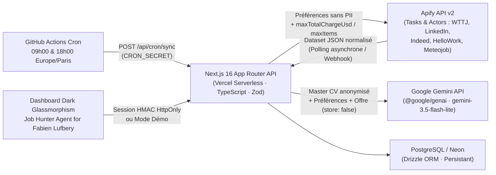

# Job Hunter Agent for Fabien Lufbery

> Assistant autonome cloud de recherche d'emploi, d'analyse IA et de préparation de candidatures personnalisées, construit autour de **deux API externes métier uniquement** (**Apify API v2** + **Google Gemini API**) et **PostgreSQL / Neon** sur **Vercel**.

- **Application déployée (Vercel)** : https://job-hunter-agent-for-fabien-lufbery.vercel.app
- **Dépôt GitHub** : https://github.com/fabienlufbery-hue/job-hunter-agent-for-fabien-lufbery

---

## 1. Architecture simplifiée (Apify + Gemini + PostgreSQL/Neon)



### Pipeline autonome (fonctionne ordinateur éteint)
`Préférences utilisateur` → `Apify (Tasks/Actors + plafonds budgétaires)` → `Récupération asynchrone & Normalisation` → `Déduplication multi-sources` → `PostgreSQL / Neon` → `Analyse Gemini (CV + préférences, note /10)` → `Classement des offres` → `Préparation des candidatures & Export PDF/DOCX` → `Suivi manuel (aucun envoi automatique)`

---

## 2. Fonctionnalités principales (7 sections)

1. **Overview (`/`)** : KPIs globaux, nouvelles offres 24h, répartition par plateforme, état réel des 3 services (Gemini, Apify, PostgreSQL/Neon), dernière recherche et prochain créneau automatique (`09h00` / `18h00 Europe/Paris`).
2. **Job Matches (`/jobs`)** : liste dédupliquée des offres réelles, score Gemini sur 10, filtres avancés (recherche, plateforme, localisation, contrat, score minimal, favoris, tri), description complète, lien original, provenance multi-sources et génération de candidature.
3. **My CV (`/cv`)** : import PDF (`unpdf`) et DOCX (`mammoth`), extraction structurée sans hallucination, édition complète et préférences professionnelles (métiers, secteurs, villes, contrats, durée, télétravail, mots-clés).
4. **Applications (`/applications`)** : éditeur de lettre de motivation côte à côte avec la description de l'offre, page de présentation, suggestions d'adaptation du CV, reformulations de bullet points, mots-clés ATS, message de candidature prêt à copier, export **PDF** (`pdf-lib`) & **DOCX** (`docx`), et tableau de **suivi manuel des candidatures**.
5. **Automation (`/automation`)** : planification `09h00` et `18h00 (Europe/Paris)` via GitHub Actions, lancement manuel complet, verrou anti-concurrence, suivi asynchrone + bouton d'arrêt des runs Apify longs, historique des exécutions et suivi des **coûts USD Apify**.
6. **Integrations (`/integrations`)** : statut réel et vérifié des **3 services uniquement** : **Google Gemini API**, **Apify API**, et **PostgreSQL / Neon**.
7. **Settings (`/settings`)** : tests de connexion réels Apify (avec découverte automatique des Tasks de votre compte) & Gemini, sélection/gestion des Actors et Tasks Apify, limites de consommation (budget mensuel, plafond par run, timeout, max offres, cooldown) et sécurité.

---

## 3. Intégration Apify API v2

- **Configuration sécurisée** : jeton `APIFY_API_TOKEN` strictement côté serveur (variables d'environnement Vercel / `.env.local`).
- **Sélection flexible** :
  - **Découverte automatique** des Apify Saved Tasks de votre compte (`GET /v2/actor-tasks`) depuis *Settings*.
  - **Catalogue vérifié Apify Store** (Indeed, LinkedIn, Welcome to the Jungle, HelloWork, Meteojob) ou saisie manuelle de n'importe quel Actor/Task ID autorisé.
  - Deux modes par source : **Lancer avec préférences & importer** (`run_and_fetch`) ou **Lire le dernier dataset réussi** (`fetch_last_dataset`, zéro coût Apify supplémentaire).
- **Contrôle des coûts & résilience** : `maxTotalChargeUsd`, `maxItems`, `timeout`, budget mensuel bloquant, verrou anti-lancements simultanés, gestion asynchrone compatible Vercel (`/api/automation/runs/[id]/poll` + webhook signé `/api/apify/webhook`).
- **Confidentialité** : aucune donnée personnelle (nom, email, téléphone, CV) n'est jamais envoyée à Apify — uniquement vos critères de recherche (mots-clés, ville, contrat).

Voir [docs/APIFY.md](docs/APIFY.md) pour la configuration détaillée.

---

## 4. Intégration Google Gemini (`@google/genai`)

- Modèles stables vérifiés (novembre 2026) : **`gemini-3.5-flash-lite`** (défaut rapide et économique) et **`gemini-3.8-flash`**, configurables via `GEMINI_MODEL`.
- Appels 100 % côté serveur avec `store: false`, anonymisation des coordonnées/nom, balises `<UNTRUSTED_*>` anti-injection de prompts, validation JSON Zod stricte, cache par hash `(CV + préférences + offre)` et interdiction absolue d'inventer des compétences, expériences ou diplômes.

---

## 5. Installation locale & Tests

```bash
git clone https://github.com/fabienlufbery-hue/job-hunter-agent-for-fabien-lufbery.git
cd job-hunter-agent-for-fabien-lufbery
npm install
cp .env.example .env.local
npm run dev
```

### Campagne de vérification

```bash
npm run lint           # ESLint (0 erreur)
npm run typecheck      # TypeScript strict (0 erreur)
npm test               # 25 tests Vitest (unitaires, intégration PostgreSQL, Apify, Gemini, sécurité)
npm run check:secrets  # Audit anti-fuite de secrets (fichiers + historique Git)
npm run build          # Build de production Next.js 16
```

Consultez [docs/SETUP.md](docs/SETUP.md) et [FINAL_REPORT.md](FINAL_REPORT.md) pour la configuration production Vercel/Neon et les résultats de qualification.
