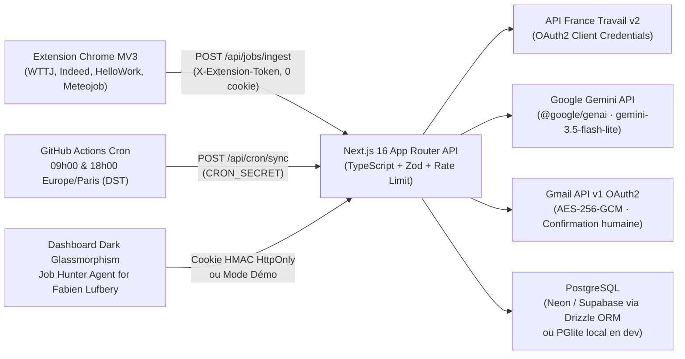

# Job Hunter Agent for Fabien Lufbery

> **Antigravity Developer Challenge — Building an Autonomous Job Search Assistant**
> Assistant de recherche d'emploi, de scoring IA Gemini, de génération de candidatures personnalisées et d'envoi Gmail encadré par validation humaine.

---

**Qualification du 27 novembre 2026.** La version corrigée se compile localement. Les appels réels France Travail, Gemini et Gmail, l’extension installée et le déploiement Vercel restent à qualifier. Le [rapport](FINAL_REPORT.md) et la [matrice](docs/COMPLIANCE_MATRIX.md) détaillent les preuves.

## 1. Objectif du projet

**Job Hunter Agent for Fabien Lufbery** automatise et structure l'ensemble du cycle de recherche d'emploi :

1. **Importation et structuration du Master CV** aux formats **PDF** et **DOCX** (sans jamais inventer de diplôme, d'expérience, de certification ou de compétence) + préférences de recherche détaillées.
2. **Moteur hybride 5 sources** normalisé et dédupliqué avec conservation de la provenance :
   - **France Travail** via l'API officielle *Offres d'emploi v2* (OAuth2 Client Credentials côté serveur).
   - **Welcome to the Jungle**, **Indeed**, **HelloWork** et **Meteojob** via une **Extension Chrome Manifest V3** dédiée (`/extension`), respectueuse des conditions d'utilisation (zéro cookie transmis, zéro contournement anti-bot/CAPTCHA, importation assistée en cas de barrière).
3. **Analyse de compatibilité Google Gemini** (score entier reproductible de **1 à 10**, 11 champs JSON strictement validés par Zod, défense anti-injection de prompts, mise en cache par hash CV/Offre).
4. **Studio de candidatures sur mesure** : lettre de motivation éditable côte à côte avec la description du poste, page de présentation, suggestions d'adaptation du CV, reformulations de bullet points, mots-clés ATS, objet/corps de mail, export **PDF** et **DOCX**.
5. **Intégration Gmail OAuth2 sécurisée** : scopes minimaux, tokens chiffrés AES-256-GCM, brouillons Gmail avec pièces jointes MIME, **envoi strictement bloqué sans validation humaine explicite** et aucune invention d'adresse email recruteur.
6. **Planification 2×/jour (09h00 & 18h00 Europe/Paris)** compatible avec les changements d'heure été/hiver et les limites réelles des offres gratuites.
7. **Interface SaaS Dark Glassmorphism** protégée par authentification personnelle, assortie d'un **Mode Démonstration Public** isolé contenant des données 100 % fictives pour l'évaluation académique.

---

## 2. Architecture logicielle



### Structure du dépôt

```text
job-hunter-agent-for-fabien-lufbery/
├── .github/workflows/
│   ├── ci.yml                     # CI (ESLint, Typecheck, Vitest, secrets, build)
│   └── daily-job-sync.yml         # Cron 09h00 & 18h00 Europe/Paris (DST-safe)
├── drizzle/schema.sql             # Schéma PostgreSQL complet
├── extension/                     # Extension Chrome Manifest V3 autonome (chargeable sans build)
│   ├── manifest.json
│   ├── background.js
│   ├── content.js
│   ├── extractors/                # common.js, wttj.js, indeed.js, hellowork.js, meteojob.js
│   ├── popup.html / popup.css / popup.js
│   └── icons/                     # PNG 16 / 48 / 128
├── scripts/
│   ├── check-secrets.sh           # Audit anti-fuite de secrets
│   ├── install-macos-launchd.sh   # Planificateur local macOS complémentaire
│   └── generate-extension-icons.mjs
├── src/
│   ├── app/                       # 7 sections UI + Login + 20+ endpoints API REST
│   ├── components/                # Composants dark glassmorphism + DashboardShell
│   ├── db/                        # Schéma Drizzle PostgreSQL + driver dual pg / PGlite
│   └── lib/                       # auth, crypto, security, cv, jobs, france-travail, gemini, export, gmail, automation, demo
├── tests/                         # 6 suites Vitest (26 tests unitaires & intégration)
├── docs/                          # SETUP.md, COMPLIANCE_MATRIX.md, TRELLO_SUBMISSION.md
├── .env.example
└── FINAL_REPORT.md
```

---

## 3. Stack technique & justification du modèle Gemini

| Couche | Technologies |
| --- | --- |
| Frontend & Backend | Next.js 16 (App Router, Turbopack), React 19, TypeScript, Tailwind CSS v4, Lucide |
| Base de données | PostgreSQL via **Drizzle ORM** (`pg` pour Neon/Supabase en prod, `@electric-sql/pglite` PostgreSQL embarqué en dev/test local ; stockage éphémère Vercel explicitement refusé) |
| Import / Export documents | `unpdf` (PDF import), `mammoth` (DOCX import), `pdf-lib` (PDF export), `docx` (DOCX export) |
| Intelligence Artificielle | SDK officiel Google **`@google/genai`** (appels 100 % côté serveur) |
| API Emploi officielle | **France Travail Offres d'emploi v2** (`OAuth2 client_credentials`) |
| Collecte navigateur | **Extension Chrome Manifest V3** (permissions minimales `storage`, `activeTab`, `alarms`) |
| Emailing sécurisé | **Gmail API v1** via `googleapis` + `nodemailer` (`MailComposer` MIME) |
| Tests & Qualité | Vitest, Zod, TypeScript strict, script `check-secrets.sh`, GitHub Actions CI |

### Note importante sur Google Gemini (`gemini-2.5-flash` → `gemini-3.5-flash-lite`)

Le sujet académique demandait initialement `gemini-2.5-flash`. Vérification effectuée le **27 novembre 2026** auprès de la documentation Google Gemini API :
- `gemini-2.5-flash` est **déprécié** (accès restreint pour les nouveaux projets) et Google redirige automatiquement ses requêtes à partir du **1er décembre 2026**.
- Le successeur officiellement recommandé par Google pour le même rapport coût/latence est **`gemini-3.5-flash-lite`** via le SDK unifié `@google/genai`.
- Le modèle reste entièrement configurable via `GEMINI_MODEL` (par défaut `gemini-3.5-flash-lite`).

---

## 4. Prérequis & installation locale

### Prérequis
- **Node.js ≥ 20** (testé sur Node.js 24.21) et **npm**
- Navigateur **Google Chrome** (pour tester l'extension MV3)
- Comptes développeurs pour activer les intégrations externes live (optionnels pour le Mode Démo local) :
  - Google AI Studio (`GEMINI_API_KEY`)
  - Portail France Travail (`FRANCE_TRAVAIL_CLIENT_ID`, `FRANCE_TRAVAIL_CLIENT_SECRET`)
  - Google Cloud Console OAuth2 (`GOOGLE_CLIENT_ID`, `GOOGLE_CLIENT_SECRET`)
  - Base PostgreSQL managée **Neon** ou **Supabase** (`DATABASE_URL`, obligatoire sur Vercel)

### Installation rapide

```bash
git clone https://github.com/fabienlufbery-hue/job-hunter-agent-for-fabien-lufbery.git
cd job-hunter-agent-for-fabien-lufbery
npm install
cp .env.example .env.local
# Éditez .env.local avec vos secrets personnels (ne jamais commiter .env.local)
npm run dev
```

Ouvrez ensuite `http://localhost:3000` :
- Cliquez sur **« Explorer le Mode Démonstration (Données Fictives) »** pour une visite complète immédiate.
- Ou connectez-vous avec les identifiants définis dans `ADMIN_EMAIL` / `ADMIN_PASSWORD` (en dev local sans configuration : `fabien.lufbery@local.dev` / `local-dev-only`).

Voir le guide complet étape par étape dans [docs/SETUP.md](docs/SETUP.md).

---

## 5. Installation de l'Extension Chrome (Manifest V3)

1. Ouvrez `chrome://extensions` dans Google Chrome.
2. Activez le **Mode développeur** (en haut à droite).
3. Cliquez sur **Charger l'extension non empaquetée** (*Load unpacked*).
4. Sélectionnez le dossier `/extension` de ce dépôt.
5. Épinglez **Job Hunter Agent for Fabien Lufbery**, ouvrez la popup → **Configuration Backend** :
   - Sélectionnez **Local (`http://localhost:3000`)** ou votre URL **Vercel Production**.
   - Saisissez votre `EXTENSION_INGEST_TOKEN` (par défaut `dev-extension-token` en local).
   - Cliquez sur **Enregistrer & Tester** (le badge passe à `Connected`).
6. Naviguez sur **Welcome to the Jungle**, **Indeed**, **HelloWork** ou **Meteojob** puis cliquez sur **1. Lire la page** → **2. Synchroniser**.

---

## 6. Automatisation (09h00 & 18h00 Europe/Paris)

- **Serveur.** Le workflow [Daily Job Sync](.github/workflows/daily-job-sync.yml) est défini à **09h00 et 18h00 Europe/Paris** avec la gestion du changement d’heure par GitHub Actions. La route associe un seul lancement à chaque créneau, et le traitement peut reprendre les offres importées par le navigateur et encore à évaluer.
- **Chrome.** L’extension tente la collecte sur les onglets déjà ouverts des plateformes autorisées. En cas de vérification, elle laisse le navigateur dans son état et signale l’action nécessaire. L’import assisté accepte les informations saisies et l’URL originale.
- **Configuration et preuve.** Les étapes Vercel, Neon, Gmail et GitHub Actions sont dans le [guide](docs/SETUP.md). Les 10 images versionnées illustrent l’interface avant cette reprise.

## 7. Déploiement Vercel

- **Nom du projet Vercel** : `job-hunter-agent-for-fabien-lufbery`
- **Région recommandée** : `cdg1` (Paris, déjà configurée dans `vercel.json`)
- **Base de données** : configurez obligatoirement `DATABASE_URL` (Neon ou Supabase PostgreSQL). Sans `DATABASE_URL` sur Vercel, l'application refuse explicitement le stockage éphémère afin de garantir l'intégrité des données.
- Configurez les variables listées dans `.env.example` dans *Vercel → Project Settings → Environment Variables*.

---

## 8. Tests et vérification

```bash
npm run typecheck      # Vérification TypeScript strict
npm test               # 26 tests unitaires & d'intégration Vitest
npm run check:secrets  # Motifs de secrets dans les fichiers et l’historique
npm run build          # Build de production Next.js 16
```

---

## 9. Limites techniques identifiées et sécurité

1. **Protections anti-bot (Indeed, etc.)** : l'extension ne contourne jamais les CAPTCHA, Cloudflare Turnstile ou murs d'authentification et ne lit jamais les cookies de session. En cas de blocage ou de changement de DOM, une alerte s'affiche et le formulaire **Importation assistée** permet d'importer l'offre consultée par l'utilisateur.
2. **Synchronisation dépendante du navigateur** : les 4 plateformes sans API publique (WTTJ, Indeed, HelloWork, Meteojob) ne peuvent pas être collectées automatiquement côté serveur lorsque Chrome est fermé.
3. **Adresses email recruteurs** : l'application n'invente jamais d'adresse email ; si l'offre n'en contient pas, l'utilisateur peut ouvrir l'offre originale ou renseigner manuellement le destinataire.
4. **Confidentialité IA** : les textes du CV et des offres sont transmis côté serveur à l'API Google Gemini uniquement lors de l'analyse, encadrés par des balises `<UNTRUSTED_*>` anti-injection de prompts.

---

## 10. Documentation complémentaire

- [Guide complet d'installation & configuration API](docs/SETUP.md)
- [Matrice de conformité académique](docs/COMPLIANCE_MATRIX.md)
- [Rapport final de qualification](FINAL_REPORT.md)
- [Texte de dépôt Trello](docs/TRELLO_SUBMISSION.md)
